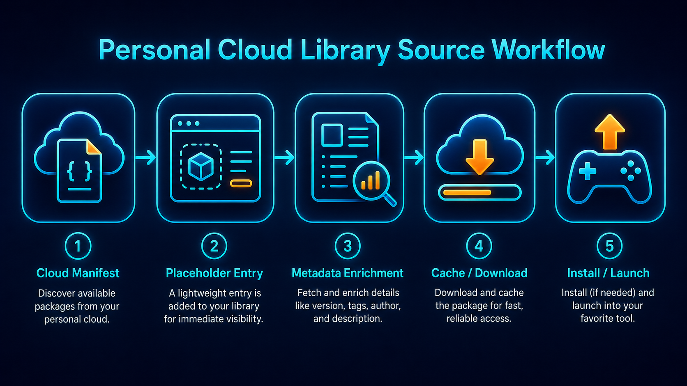
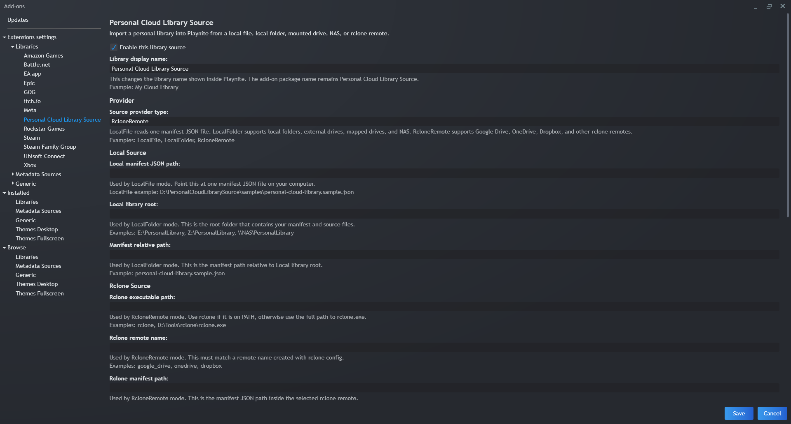
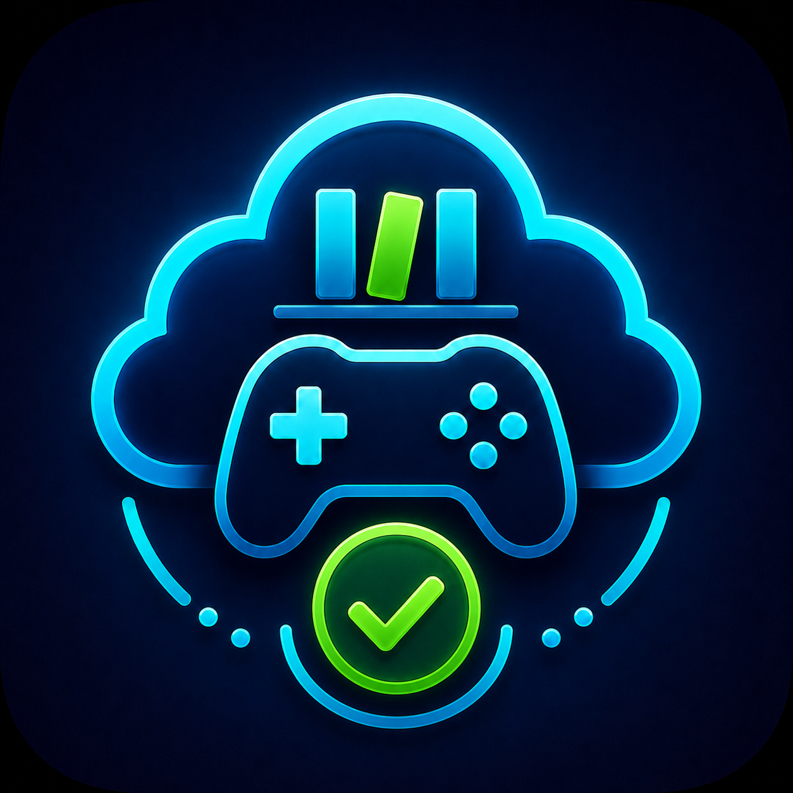
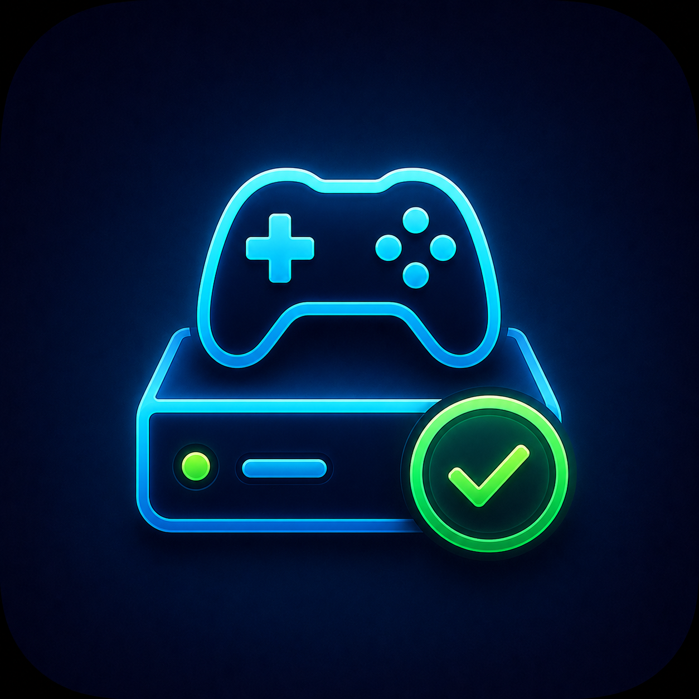
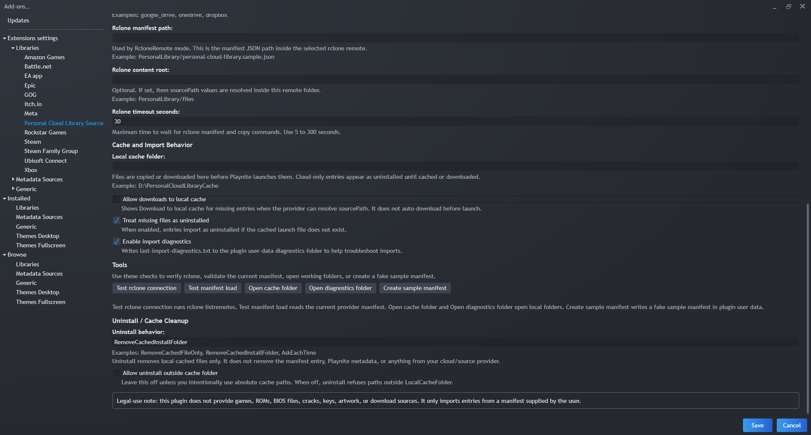

# CHR Cloud Library

This fork is a standalone Playnite extension, based on Personal Cloud Library Source by The Bearclaw and ztwslayer. It has its own add-on UUID, assembly and theme-control namespace; upstream updates do not replace it. See [download center and migration](docs/download-center-and-migration.md) before switching an existing library.

## How This Works



Personal Cloud Library Source lets users keep a record of their personal cloud, NAS, external-drive, or local library inside Playnite. Entries can appear before they are downloaded, so the library can be organized, filtered, and enriched with metadata first, then cached locally later.

This supports a download/cache workflow:

1. Import entries from a user-supplied manifest.
2. View and organize those entries inside Playnite.
3. Use Playnite's metadata tools to add covers, descriptions, genres, screenshots, and other details.
4. Download or copy selected entries to a local cache when ready.
5. Launch cached entries locally through Playnite.
6. Remove cached copies later while keeping the catalog entry in the library.

This is not a gameplay streaming service. It does not provide games, ROMs, BIOS files, cracks, keys, copyrighted content, scraping, or download sources. It catalogs user-supplied entries and copies or downloads user-owned files from configured local folders or rclone remotes.

## Features

- Normal Playnite `GameLibrary` integration.
- Provider modes for `LocalFile`, `LocalFolder`, and `RcloneRemote`.
- Local folder, external drive, mounted drive, and NAS support.
- Google Drive, OneDrive, Dropbox, and other cloud providers through rclone.
- Cloud-only entries imported as uninstalled.
- Cached entries imported as installed with a Play action.
- Manual `Download to local cache` action when a provider can resolve `sourcePath`.
- Manual `Remove cached copy` action for installed/cached entries.
- Optional import diagnostics.
- Customizable library display name inside Playnite.
- Desktop top-panel download center with live per-game progress and persistent operation history.
- A separate extension identity, with explicit adoption of legacy settings and existing game records.

## Playnite Metadata

Imported entries behave like normal Playnite library entries. After import, users can use Playnite's existing metadata download tools and metadata providers to add covers, descriptions, genres, screenshots, and other details.

Metadata can be prepared before downloading or installing the actual file, as long as the entry exists in Playnite. Cached or downloaded entries can then launch normally.

## What This Plugin Does Not Provide

This plugin does not provide games, ROMs, BIOS files, cracks, keys, copyrighted content, scraping, storefront access, or download sources.

It only catalogs user-supplied manifest entries and copies or downloads user-owned files from configured local folders or rclone remotes.

## Nightly builds of this fork

The standalone version described here is a private candidate until explicitly published. Existing **[Releases → Nightly](https://github.com/C-H-Rm/PersonalCloudLibrarySource/releases/tag/nightly)** assets may still use the legacy identity; check the package's name and release notes before switching. The official add-on browser installs upstream, not CHR Cloud Library.

The existing verified Windows build updates this single prerelease after successful builds of `main` (including manual runs on `main`). Pull requests and failed builds cannot publish. The release includes the installable package, SHA-256 checksum and source build receipt. Release downloads do not have the Actions artifact retention deadline. Stable releases are not changed; this is not an automatic Playnite add-on update channel.

## Installation for Users

Install **CHR Cloud Library** from its standalone `.pext`, not the upstream add-on-browser listing.

1. If switching from the original extension, finish any transfers and disable it in Add-ons, then restart. Keep its data and library entries for adoption.
2. Open `CHRCloudLibrary-<version>.pext` with Playnite and restart when prompted.
3. Choose the explicit legacy-adoption prompt to keep existing settings and game records, or set up a separate fresh library. See the migration guide below; do not delete and reimport the old games.
4. For inline Daze progress, install the matching **Daze - Cloud Progress** theme version 2.3.1.3 or newer. Its independent `CHRCL_InstallProgress` host replaces the earlier test-build provider. The top-panel download center does not require the custom theme.
5. For a fresh setup, select a provider in the plugin settings and run **Update Game Library**.



The provider settings choose where the manifest is read from. The cache settings choose where files are downloaded or copied before Playnite launches them.

Users who prefer manual installation can also download the packaged `.pext` file from the GitHub Releases page and open it with Playnite.

## Requirements

- Playnite installed.
- A user-created manifest file.
- A local cache folder where downloaded or copied entries can be stored.
- rclone, only if using the `RcloneRemote` provider mode.

Local files, external drives, mapped drives, and NAS paths do not require rclone unless the user chooses to use rclone for that setup.

## Building From Source for Developers

1. Build the project using **Debug Any CPU**.
2. Add the build output folder as a Playnite external extension:

   ```text
   D:\PersonalCloudLibrarySource\PersonalCloudLibrarySource\bin\Debug
   ```

3. Restart Playnite.
4. Configure a test manifest and run **Update Game Library**.

To create a local `.pext` package for testing or manual installation:

```powershell
.\tools\package-extension.ps1
```

For normal user installation, use the supplied standalone `.pext` instead of building from source. Playnite's official add-on-browser listing installs the upstream extension, not this fork.

## Provider Modes

### LocalFile

Reads a manifest from `LocalManifestPath`.

If downloads are enabled, `sourcePath` can be absolute or relative to the manifest folder.

### LocalFolder, External Drive, or NAS

Reads a manifest from:

```text
LocalLibraryRoot + ManifestRelativePath
```

Copies item files from:

```text
LocalLibraryRoot + sourcePath
```

Use this mode for local folders, external drives, mapped drives, and NAS paths.

### RcloneRemote

Reads a manifest with:

```text
rclone cat remote:manifestPath
```

Copies item files with:

```text
rclone copyto remote:sourcePath localCachePath
```

Use this for Google Drive, OneDrive, Dropbox, and other providers supported by rclone.

## LocalFile Setup

```text
SourceProviderType = LocalFile
LocalManifestPath = D:\PersonalCloudLibrarySource\samples\personal-cloud-library.sample.json
LocalCacheFolder = D:\PersonalCloudLibraryCache
AllowDownloads = true
TreatMissingFilesAsUninstalled = true
EnableDiagnostics = true
```

## LocalFolder, External Drive, or NAS Setup

```text
SourceProviderType = LocalFolder
LocalLibraryRoot = E:\PersonalLibrary
ManifestRelativePath = personal-cloud-library.sample.json
LocalCacheFolder = D:\PersonalCloudLibraryCache
AllowDownloads = true
```

NAS example:

```text
LocalLibraryRoot = \\NAS\PersonalLibrary
```

## Google Drive via Rclone Setup

Configure a Google Drive remote with `rclone config`, then map the plugin settings:

```text
SourceProviderType = RcloneRemote
RcloneExecutablePath = rclone
RcloneRemoteName = google_drive
RcloneManifestPath = PersonalLibrary/personal-cloud-library.sample.json
RcloneContentRoot = PersonalLibrary/files
RcloneTimeoutSeconds = 30
LocalCacheFolder = D:\PersonalCloudLibraryCache
AllowDownloads = true
```

## OneDrive via Rclone Setup

Configure a OneDrive remote with `rclone config`, then use the same `RcloneRemote` settings pattern:

```text
RcloneRemoteName = onedrive
RcloneManifestPath = PersonalLibrary/personal-cloud-library.sample.json
RcloneContentRoot = PersonalLibrary/files
```

## Manifest Setup

Recommended v2 manifests use `sourcePath` for the provider source and `cachePath` for the local cached launch file.

```json
{
  "version": 2,
  "items": [
    {
      "id": "example-adventure",
      "title": "Example Adventure",
      "platform": "Example Platform",
      "sourcePath": "ExampleAdventure/ExampleAdventure.bat",
      "cachePath": "ExampleAdventure\\ExampleAdventure.bat",
      "installDirectory": "ExampleAdventure",
      "launchFile": "ExampleAdventure.bat",
      "notes": "Fake local sample entry for testing."
    }
  ]
}
```

See [docs/manifest-format.md](docs/manifest-format.md).

## Download and Cache Behavior

The plugin never downloads automatically before launch. Missing entries remain visible as uninstalled when `TreatMissingFilesAsUninstalled` is enabled.

Use `Download to local cache` manually when `AllowDownloads` is enabled and the provider can resolve `sourcePath`.



Cloud-only entries are catalog entries without a cached local launch file. They can still exist in Playnite, use Playnite metadata, and become playable later after download or copy to the local cache.



Cached entries have a local launch file and can launch locally through Playnite.

## Uninstall and Cache Cleanup

Playnite uninstall support removes local cached copies only. It does not remove cloud/source files, does not edit the manifest, and does not remove the Playnite game entry.



By default, uninstall removes the cached install folder under `LocalCacheFolder`. You can change this with:

```text
UninstallBehavior = RemoveCachedInstallFolder
```

Supported values:

- `RemoveCachedFileOnly`
- `RemoveCachedInstallFolder`
- `AskEachTime`

`AllowUninstallOutsideCacheFolder` defaults to `false`. Leave it off unless you intentionally use absolute cache paths outside `LocalCacheFolder`.

After removing the cached copy and updating the library, the manifest entry remains in Playnite as an uninstalled/cloud-only entry. Existing Playnite metadata can remain attached to the entry.

## Troubleshooting

See [docs/troubleshooting.md](docs/troubleshooting.md) for common setup and visibility issues.

## Privacy and Legal Use

Personal Cloud Library Source reads user-supplied paths and manifests. It does not include private cloud IDs, native cloud API credentials, bundled content, games, ROMs, BIOS files, cracks, or keys.

See [docs/legal-use.md](docs/legal-use.md).

## Release and Add-on Browser Notes

**Personal Cloud Library Source** is publicly available through Playnite's official add-on browser.

Most users should install it from:

```text
Playnite → Main Menu → Add-ons → Browse → Personal Cloud Library Source
```

The `playnite-addon/` folder is kept for release maintenance and add-on database metadata.

- Installer manifest: `playnite-addon/installer.yaml`
- Database listing helper: `playnite-addon/addon-database.yaml`

`AddonId` must continue to match `PersonalCloudLibrarySource/extension.yaml` exactly. The repository and release assets must remain public so Playnite's add-on browser can install and update the package correctly.

## Roadmap

- Improve setup guidance and first-run user experience.
- Add stronger manifest validation and friendlier error messages.
- Add cache verification and optional hash checks.
- Add automatic manifest generation based on file structures and naming conventions.
- Auto-fill source paths for game installations where possible.
